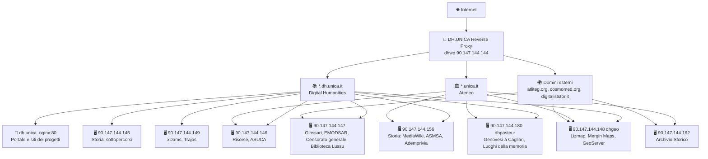

# 🌐 DH.UNICA Reverse Proxy

<div align="center">
  
[](https://www.docker.com/)
[](https://nginx.org/)
[](https://letsencrypt.org/)
[](https://www.unica.it/)

*Un reverse proxy nginx containerizzato per l'ecosistema Digital Humanities dell'Università di Cagliari*

</div>

---

## 📋 Panoramica

Questo progetto implementa un **reverse proxy nginx** ad alta disponibilità che gestisce il traffico per **37 host pubblici e 59 URL HTTPS** dell'Università di Cagliari, principalmente focalizzati sulle Digital Humanities. Il sistema route intelligentemente le richieste tra domini pubblici e servizi backend distribuiti.

- 🐳 **Containerizzato** - Deployment semplificato con Docker
- 🔐 **SSL/TLS Completo** - Certificati DigiCert CA e Let's Encrypt
- 🌍 **Multi-dominio** - Supporto per domini `.unica.it`, `.dh.unica.it` e domini esterni
- ⚡ **Alta Performance** - Compressione gzip e ottimizzazioni avanzate
- 🛡️ **Sicurezza** - Protezione PHP, autenticazione e headers di sicurezza

---

## 🏗️ Architettura



---

## 🚀 Quick Start

### Prerequisiti

- 🐳 Docker & Docker Compose
- 🔐 Certificati SSL (DigiCert CA o Let's Encrypt)
- 🌐 Accesso alla rete dei server backend

### Installazione Rapida

```bash
# Clone del repository
git clone https://github.com/caprowsky/proxy.dh.unica.git
cd proxy.dh.unica

# Avvio del reverse proxy
docker-compose up -d

# Verifica dello stato
docker logs dhunica_proxypass
```

### Configurazione SSL

```bash
# Posiziona i certificati nelle directory appropriate:
# - DigiCert CA: /etc/digicertca/live/dh.unica.it/
# - Let's Encrypt: /etc/letsencrypt/live/domain/

# Rinnovo MANUALE dei certificati Let's Encrypt (forzatura).
# Il rinnovo automatico e' gia' attivo: vedi "Rinnovo automatico Let's Encrypt".
./nginx-certs.sh
```

---

## 🛠️ Gestione Operativa

### Comandi Principali

| Comando | Descrizione | Uso |
|---------|-------------|-----|
| `./nginx-reload.sh` | 🔄 Ricarica configurazione senza downtime | Modifiche alle configurazioni |
| `./nginx-restart.sh` | 🔄 Restart completo del container | Cambiamenti strutturali |
| `./nginx-reset.sh` | 🔄 Rebuild completo | Problemi critici |
| `./nginx-certs.sh` | 🔐 Rinnovo **manuale** dei certificati Let's Encrypt | Solo per forzare un rinnovo: quello automatico e' gia' attivo |
| `./scripts/install-certbot-deploy-hook.sh` | 🔐 (Re)installa il deploy hook di certbot | Dopo un reinstall del server o se l'hook viene perso |
| `python3 scripts/check_ssl_expiry.py` | 📅 Scadenze di tutti i virtual host | Controllo periodico, produce `scripts/ssl_expiry_report.csv` |

### Aggiungere un Nuovo Sito

1. **Richiedi il record DNS** aprendo un ticket su [helpdesk.unica.it/servicePortal](https://helpdesk.unica.it/servicePortal), destinato al Supporto Tecnico / Team di Rete. Per i sottodomini `dh.unica.it` **non esiste un wildcard DNS**: ogni sottodominio va richiesto singolarmente, anche se il certificato SSL (`*.dh.unica.it`) è già wildcard e non richiede modifiche.

   Testo della richiesta (sostituisci i placeholder):
   ```text
   Spett.le Supporto Tecnico / Team di Rete,

   Si richiede gentilmente l'aggiunta/configurazione del seguente record DNS:

   Hostname (FQDN): <NUOVO_SOTTODOMINIO>.dh.unica.it
   Tipo Record: Record A
   Indirizzo IP: 90.147.144.144

   Resto a disposizione per eventuali chiarimenti o informazioni aggiuntive.

   Cordiali saluti,
   <NOME_RICHIEDENTE>
   ```

   Attendi la propagazione del record prima di proseguire (verifica con `dig +short <NUOVO_SOTTODOMINIO>.dh.unica.it`).

2. **Crea il file di configurazione** in `sites-enabled/`:
```bash
# Per sottodomini DH: sottodominio_dhunica.conf
# Per domini UNICA: dominio.conf  
# Per domini esterni: dominio.conf
```

3. **Configura SSL proof directory**:
```bash
mkdir -p ssl-proof/nuovo-dominio/
```

4. **Applica la configurazione**:
```bash
./nginx-reload.sh
```

### Monitoraggio e Debug

```bash
# Log del container
docker logs dhunica_proxypass

# Test configurazione nginx
docker exec dhunica_proxypass nginx -t

# Verifica connessioni backend
curl -I https://storia.dh.unica.it/colonizzazioninterne
```

---

## 🌍 Siti Web Gestiti

Elenco ricavato dai file in `sites-enabled/` e verificato il 2/11/2026. Per ogni URL la tabella in [doc/SITI_WEB_REVERSE_PROXY.md](doc/SITI_WEB_REVERSE_PROXY.md) riporta backend, certificato e descrizione.

**Ultimi aggiunti:** `lizmap.dh.unica.it` e `mergin.dh.unica.it`, verso dhgeo (2/11/2026).

### 📊 Numeri

- **37 host pubblici**: 36 in HTTPS più `www.thelastofus.it`, solo HTTP
- **23 sottopercorsi** inoltrati a un backend diverso da quello dell'host
- **8 VM backend** (da 90.147.144.145 a .180) e **3 container** sulla stessa macchina del proxy: `dh.unica_nginx`, `labimus_apache_1`, `almanaccostampasarda_mockup`

### 📚 dh.unica.it (certificato wildcard DigiCert `*.dh.unica.it`)

| Host | Backend | Sottopercorsi con backend propri |
|---|---|---|
| https://dh.unica.it | `dh.unica_nginx` | |
| https://almanaccostampasarda.dh.unica.it | `dh.unica_nginx` | |
| https://architettura.dh.unica.it | `dh.unica_nginx` | |
| https://archivistica.dh.unica.it | `dh.unica_nginx` | `/censoratogenerale` (.147:9000), `/asuca` (.146:8000) |
| https://arte.dh.unica.it | `dh.unica_nginx` | |
| https://artemusei.dh.unica.it | `dh.unica_nginx` | |
| https://asuca.dh.unica.it | `dh.unica_nginx` | |
| https://cinema.dh.unica.it | `dh.unica_nginx` | |
| https://doc.dh.unica.it | `dh.unica_nginx` | |
| https://docs.dh.unica.it | `dh.unica_nginx` | |
| https://editoria.dh.unica.it | `dh.unica_nginx` | |
| https://filologia.dh.unica.it | `dh.unica_nginx` | |
| https://geo.dh.unica.it | `dh.unica_nginx` | `/geoserver` (.148:80) |
| https://geografia.dh.unica.it | `dh.unica_nginx` | |
| https://glossari.dh.unica.it | .147:3001 | `/admin`, `/api/` (.147:3000) |
| https://letteratura.dh.unica.it | `dh.unica_nginx` | |
| https://libriebiblioteche.dh.unica.it | `dh.unica_nginx` | `/biblioteca-lussu` (.147:8080) |
| https://linguistica.dh.unica.it | `dh.unica_nginx` | `/emodsar` (.147:8000) |
| https://lizmap.dh.unica.it | .148:8084 (dhgeo) | `/files/` (.148:8087, Filebrowser) |
| https://ludica.dh.unica.it | `dh.unica_nginx` | |
| https://mergin.dh.unica.it | .148:8086 (dhgeo) | |
| https://musica.dh.unica.it | `dh.unica_nginx` | `/labimus` (`labimus_apache_1`), `/trajos` (.149:9000) |
| https://risorse.dh.unica.it | .146:7000 | |
| https://storia.dh.unica.it | `dh.unica_nginx` | `/storiedigitali` (.145:7000), `/archiviodigitalerisorgimento` (.145:8000), `/colonizzazioninterne` (.145:4000), `/risorse_omc` (.145:5000), `/risorse` (.145:6000), `/mediawiki` (.156:8000), `/asmsa` (.156:6000), `/ademprivia` (.156:5000), `/genovesi_cagliari` (.180:6000), `/luoghimemoriaeuropa` (.180:8000), `/almanaccostampasarda/` (`almanaccostampasarda_mockup`, con password) |
| https://studiericerche.dh.unica.it | `dh.unica_nginx` | |
| https://ticket.dh.unica.it | `dh.unica_nginx` | |
| https://xdams.dh.unica.it | `dh.unica_nginx` | `/xDams` (.149:80) |

### 🏛️ unica.it

| Host | Backend | Certificato |
|---|---|---|
| https://400.unica.it | .156:7000 | DigiCert dedicato |
| https://aiucd2026.unica.it | .180:7000 | Let's Encrypt (`www.` rimanda al dominio senza www) |
| https://archiviostorico.unica.it | .162:5000 | DigiCert |
| https://humanities.unica.it | .148:7000 | DigiCert dedicato |
| https://patrimonio.archiviostorico.unica.it | .146:9000 | DigiCert |
| https://patrimonio-web.archiviostorico.unica.it | .146:8000 | DigiCert |

### 🌍 Domini esterni

| Host | Backend | Certificato |
|---|---|---|
| https://atlante.atliteg.org | .147:9000 | Let's Encrypt |
| https://www.cosmomed.org | .148:9000 | Let's Encrypt |
| https://www.digitaliststor.it | .162:8000, `/risorse` su .162:6000 | Let's Encrypt |
| http://www.thelastofus.it | non servito | nessuno: il nome non risolve nel DNS; il blocco verso .156:5000 è ignorato da nginx (nome duplicato) |

Gli indirizzi abbreviati (.145, .147, …) stanno tutti in 90.147.144.0/24.

---

## ⚙️ Configurazione Tecnica

### Struttura Directory

```
proxy.dh.unica/
├── 🐳 docker-compose.yml          # Configurazione container
├── 📋 Dockerfile                  # Immagine nginx custom
├── ⚙️ sites-enabled/              # Configurazioni nginx
│   ├── dhunica.conf              # Dominio principale
│   ├── *_dhunica.conf            # Sottoprogetti DH
│   └── *.conf                    # Altri domini
├── 🔐 ssl-proof/                 # Directory SSL proof
├── 🔑 htpassword/                # File autenticazione
├── 🔄 redirect/                  # Configurazioni redirect
├── 🌐 html/                      # Contenuti statici
└── 📜 scripts di gestione        # nginx-*.sh
```

### Pattern Configurazione Nginx

Ogni sito segue questo template standardizzato:

```nginx
server {
    listen 80;
    server_name example.dh.unica.it;
    return 301 https://example.dh.unica.it$request_uri;
}

server {
    listen 443 ssl;
    server_name example.dh.unica.it;
    
    # SSL Certificates
    ssl_certificate /etc/digicertca/live/dh.unica.it/Cert_bundle.pem;
    ssl_certificate_key /etc/digicertca/live/dh.unica.it/dh.key;
    
    # SSL Proof per ACME challenges
    location /.well-known {
        root /var/www/ssl-proof/dhunica/;
    }
    
    # Proxy principale
    location / {
        proxy_pass http://backend:port;
        proxy_set_header Host $host;
        proxy_set_header X-Forwarded-Proto $scheme;
        # ... altri headers standard
    }
    
    # Sicurezza PHP
    location ~* /files/.*.php$ {
        deny all;
    }
}
```

### Ottimizzazioni Performance

- **Compressione gzip** attiva su tutti i siti
- **Client max body size**: 4000MB per upload grandi
- **Proxy timeout**: 900 secondi per operazioni lunghe  
- **Buffer ottimizzati** per traffico intenso

---

## 🔒 Sicurezza e SSL

### Strategia Certificati

| Tipo Domain | Certificato | Path |
|-------------|-------------|------|
| `*.dh.unica.it` | DigiCert CA | `/etc/digicertca/live/dh.unica.it/` |
| `*.unica.it` | DigiCert CA | `/etc/digicertca/live/domain/` |
| Domini esterni | Let's Encrypt | `/etc/letsencrypt/live/domain/` |

### Rinnovo automatico Let's Encrypt

Il rinnovo si compone di **due pezzi che devono funzionare entrambi**:

| # | Pezzo | Dove | Cosa fa |
|---|-------|------|---------|
| 1 | `snap.certbot.renew.timer` | systemd (host) | Esegue `certbot renew` 2 volte al giorno; rinnova i certificati a meno di 30 giorni dalla scadenza |
| 2 | `00-reload-dhunica-proxy.sh` | `/etc/letsencrypt/renewal-hooks/deploy/` | Deploy hook: ricarica nginx nel container **dopo** ogni rinnovo |

⚠️ **Il pezzo 2 e' indispensabile.** Nginx legge i certificati all'avvio e li tiene
in memoria: se il file su disco viene rinnovato ma nginx non viene ricaricato, il
proxy continua a servire il certificato vecchio fino alla scadenza. E' esattamente
il guasto capitato ad `atlante.atliteg.org`, con il certificato rinnovato
l'08/08/2026 e quello servito scaduto il 07/09/2026 (container up da 4 mesi).

Sorgente versionato dell'hook: [`scripts/certbot-deploy-hook.sh`](scripts/certbot-deploy-hook.sh).
Installazione / reinstallazione:

```bash
# Sul server del proxy
cd /home/dhwp/proxy.dh.unica
./scripts/install-certbot-deploy-hook.sh                # via sudo
./scripts/install-certbot-deploy-hook.sh --via-docker    # senza sudo (gruppo docker)
```

**Rete di sicurezza** (terzo livello, in cron come utente `dhwp`): un reload
graceful giornaliero garantisce che un certificato nuovo entri in servizio entro
24 ore anche se l'hook venisse rimosso o fallisse.

```cron
30 4 * * * /home/dhwp/proxy.dh.unica/scripts/nginx-reload-safety-net.sh
```

#### Verifiche

```bash
# Timer di rinnovo attivo e prossima esecuzione
systemctl list-timers snap.certbot.renew.timer

# Prova a vuoto del rinnovo, hook inclusi
sudo certbot renew --dry-run --run-deploy-hooks

# Scadenze di tutti i virtual host (cert su disco + cert effettivamente servito)
python3 scripts/check_ssl_expiry.py

# Certificato realmente servito per un dominio
echo | openssl s_client -servername DOMINIO -connect DOMINIO:443 2>/dev/null \
  | openssl x509 -noout -dates

# Log del deploy hook
sudo tail /var/log/certbot-deploy-hook.log
```

### Misure di Sicurezza

- ✅ **Redirect HTTPS automatico** per tutti i domini
- ✅ **Blocco file PHP** in directory uploads (`/files/`)
- ✅ **Headers di sicurezza** standard
- ✅ **Autenticazione HTTP Basic** disponibile
- ✅ **SSL proof directories** per validazione certificati

---

## 🔧 Troubleshooting

### Problemi Comuni

<details>
<summary><strong>🔴 Sito non raggiungibile</strong></summary>

```bash
# Verifica stato container
docker ps | grep dhunica

# Controlla logs
docker logs dhunica_proxypass

# Test configurazione
docker exec dhunica_proxypass nginx -t
```
</details>

<details>
<summary><strong>🔴 Certificato scaduto o errore SSL</strong></summary>

**Prima di tutto: distinguere il certificato su disco da quello servito.** Sono
due cose diverse e nella maggior parte dei casi il problema sta nella differenza
fra le due.

```bash
# 1. Cosa sta servendo nginx adesso (dall'esterno)
echo | openssl s_client -servername DOMINIO -connect DOMINIO:443 2>/dev/null \
  | openssl x509 -noout -dates

# 2. Cosa c'e' su disco
sudo openssl x509 -in /etc/letsencrypt/live/DOMINIO/fullchain.pem -noout -dates
# senza sudo, sfruttando il bind mount del container:
docker exec dhunica_proxypass cat /etc/letsencrypt/live/DOMINIO/fullchain.pem \
  | openssl x509 -noout -dates
```

| Esito del confronto | Causa | Rimedio |
|---|---|---|
| Su disco e' **valido**, servito e' **scaduto** | Nginx non e' stato ricaricato dopo il rinnovo: tiene in memoria i certificati letti all'avvio | `docker exec dhunica_proxypass nginx -s reload`, poi verificare che il deploy hook sia installato (vedi sotto) |
| Scaduto **anche su disco**, dominio Let's Encrypt | Il rinnovo non e' andato a buon fine | `sudo certbot renew --force-renewal -d DOMINIO` e leggere `/var/log/letsencrypt/letsencrypt.log` |
| Scaduto **anche su disco**, dominio DigiCert (`*.unica.it`) | Certificato commerciale: certbot non c'entra | Va richiesto all'ateneo e installato in `/etc/digicertca/live/` |

⚠️ Il primo caso e' quello che ha fatto cadere `atlante.atliteg.org` a settembre
2026: certificato rinnovato regolarmente l'08/08, container up da 4 mesi, quindi
il proxy ha continuato a servire il certificato di giugno fino alla scadenza del
07/09. Se ricapita, controllare **subito** che il deploy hook esista:

```bash
ls -l /etc/letsencrypt/renewal-hooks/deploy/    # deve contenere 00-reload-dhunica-proxy.sh
sudo tail /var/log/certbot-deploy-hook.log      # deve mostrare un reload per ogni rinnovo
```
</details>

<details>
<summary><strong>🔴 Backend non risponde</strong></summary>

```bash
# Test connettività backend
curl -I http://90.147.144.145:7000
curl -I http://dh.unica_nginx:80

# Verifica reti Docker
docker network ls | grep dhunica
```
</details>

### Log e Monitoring

```bash
# Monitoring in tempo reale
docker logs -f dhunica_proxypass

# Analisi errori
docker logs dhunica_proxypass 2>&1 | grep -i error

# Test completo connettività
for url in storia.dh.unica.it arte.dh.unica.it; do
  echo "Testing $url..."
  curl -I "https://$url"
done
```

**Log rilevanti**

| File | Contenuto |
|------|-----------|
| `/var/log/certbot-deploy-hook.log` | Un reload di nginx per ogni certificato rinnovato. **Se resta vuoto per mesi mentre i certificati vengono rinnovati, il deploy hook non sta girando** |
| `/var/log/letsencrypt/letsencrypt.log` | Esito dei rinnovi certbot (richiede sudo) |
| `logs/nginx-reload-safety-net.log` | Reload graceful giornaliero della rete di sicurezza |
| `/home/dhwp/auto-deploy.log` | Auto-deploy da git (gira ogni minuto) |
| `logs/nginx/` | Access ed error log di nginx |

---

## 🤝 Contributi

### Sviluppo

1. **Fork** del repository
2. **Crea branch** per la feature: `git checkout -b feature/nuovo-sito`  
3. **Commit** delle modifiche: `git commit -am 'Add nuovo sito'`
4. **Push** del branch: `git push origin feature/nuovo-sito`
5. **Pull Request** per review

### Convenzioni

- **Naming**: Seguire i pattern esistenti per i file `.conf`
- **SSL**: Configurare sempre SSL proof directory
- **Testing**: Testare con `nginx -t` prima del deploy
- **Documentation**: Aggiornare `SITI_WEB_REVERSE_PROXY.md`

⚠️ **Modifiche fatte a mano sul proxy vanno committate.** `auto-deploy.sh` gira
ogni minuto e, appena trova un commit nuovo su `origin/master`, azzera il
working tree su quel commit: qualsiasi modifica non committata presente sul
server viene cancellata dal primo push utile, anche se fatta da qualcun altro
mesi prima. Prima di pushare, controllare sempre lo stato del repo in
produzione:

```bash
ssh dhwp@90.147.144.144 'cd /home/dhwp/proxy.dh.unica && git status --short && git diff'
```

(I file untracked invece sopravvivono all'azzeramento.)

---

## 📚 Documentazione

- 📋 **[Lista Completa Siti](/doc/SITI_WEB_REVERSE_PROXY.md)** - Tutti i 47 siti web gestiti
- ⚙️ **[Copilot Instructions](.github/copilot-instructions.md)** - Guide per AI agents  
- 🐳 **[Docker Compose](docker-compose.yml)** - Configurazione container
- 📜 **[Scripts di Gestione](nginx-*.sh)** - Automazione operazioni
- 🔐 **[Deploy hook SSL](scripts/certbot-deploy-hook.sh)** - Reload di nginx dopo ogni rinnovo certificato
- 🛟 **[Rete di sicurezza SSL](scripts/nginx-reload-safety-net.sh)** - Reload graceful giornaliero da cron
- 📅 **[Check scadenze SSL](scripts/check_ssl_expiry.py)** - Report su tutti i virtual host

---

## 📄 Licenza

Questo progetto è sviluppato per l'**Università di Cagliari** - Dipartimento Digital Humanities.

---

## 👥 Contatti

- 🏛️ **Università di Cagliari** - [unica.it](https://www.unica.it)
- 📚 **Digital Humanities** - [dh.unica.it](https://dh.unica.it)
- 💻 **Repository** - [github.com/caprowsky/proxy.dh.unica](https://github.com/caprowsky/proxy.dh.unica)

---

<div align="center">

**Fatto con ❤️ per la comunità Digital Humanities dell'Università degli Studi di Cagliari**

[](https://www.unica.it/)

</div># Last update: ven 3 ott 2025, 12:51:16, CEST
# Webhook deploy system configured - ven 3 ott 2025, 16:48:10, CEST 
